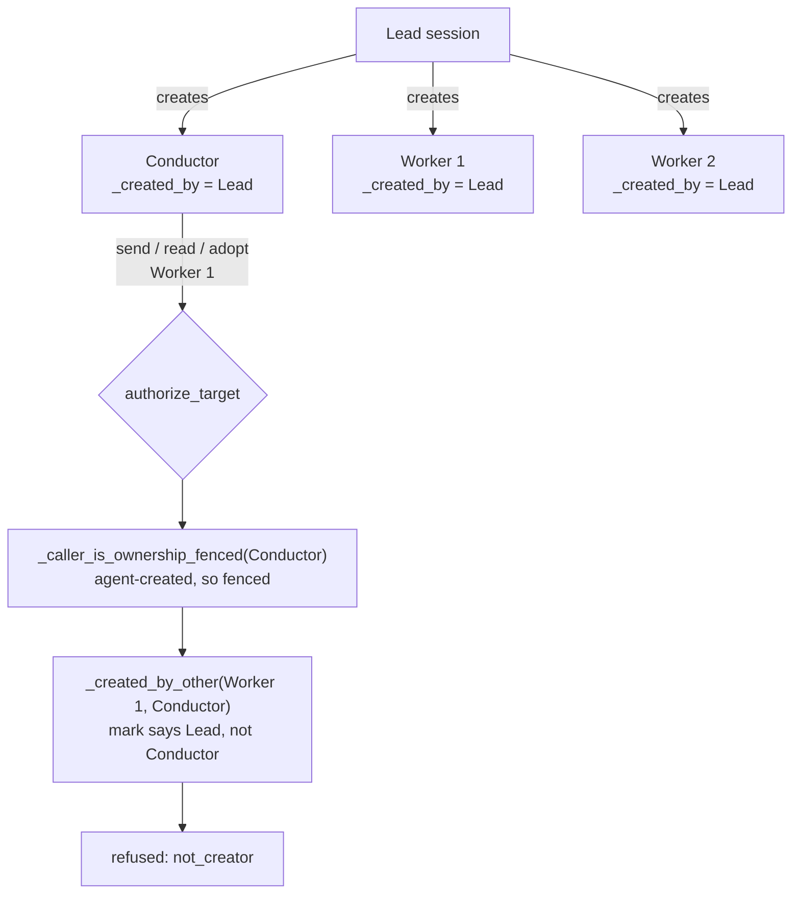
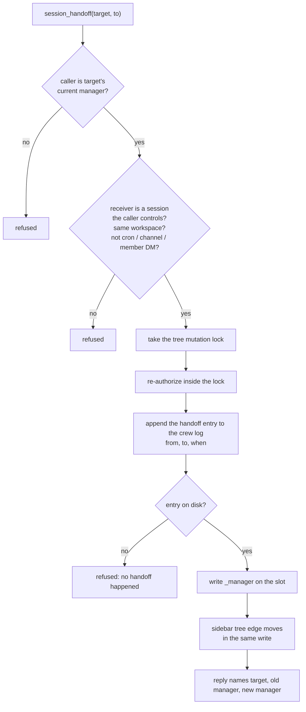
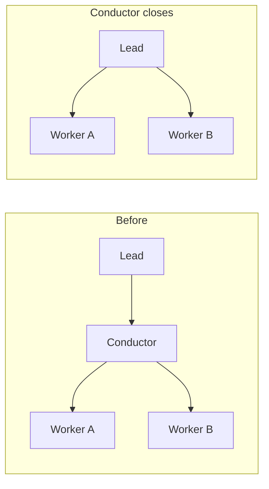

# RFC: Session Control Handoff

## What this changes

Today a session can only control the sessions it created itself. That rule is
written once, in `authorize_target`, and every session-control verb goes through
it: send, read, stop, close, adopt, release, rename. The creator mark it reads,
`_created_by`, is stamped at birth and never changes afterwards.

This document proposes a second field beside it, `_manager`, and one new verb,
`session_handoff`, that writes it. `_created_by` keeps saying who made the
session. `_manager` says who is responsible for it now. The fence stops reading
"did you create this" and starts reading "are you this session's manager, or
above its manager".

`_manager` defaults to `_created_by`. A gateway where nobody calls
`session_handoff` behaves exactly as it does today, because every session's
manager is still its creator and the fence answers the same question with the
same value.

The thing this unlocks is plain: a lead can open a conductor and the workers that
conductor should run, and then give the workers to it. Right now the lead can
open all of them and the conductor can reach none of them.

## Why today's rules refuse this

Three functions produce the refusal, and each is doing its own job correctly.

`_caller_is_ownership_fenced` decides whether a caller is restricted to its own
creations. It answers yes for four kinds of caller: a crew member's DM session, a
cron job's own session, a channel-linked session, and **any session an agent
created** — which it reads straight off the slot's own `_created_by` mark. That
last clause is what matters here. Every session a lead or a conductor opens is
agent-created, so every one of them is fenced.

`_created_by_other` decides whether a given target was made by this caller. It
compares the target's `_created_by` against the caller's slot key, and a blank
mark matches nobody, so an unattributed session is unreachable to a fenced
caller rather than open to all of them.

`authorize_target` puts the two together. A fenced caller addressing a session it
did not create is refused with the code `not_creator`.

Now walk the case the issue describes. A lead opens a conductor and three
workers. All four carry `_created_by = <the lead's slot key>`. The conductor is
agent-created, so it is fenced. Every worker's creator is the lead, not the
conductor. So the conductor is refused on every worker, for every verb, and also
on a send back to the lead, whose own mark names neither of them.

The obvious workaround does not work either. `adopt_target` is the takeover verb,
and it looks like it should fix this: it makes the target hang under the calling
session. But it writes only the sidebar tree edge, through
`on_session_adopted` in the crew log, and it never touches `_created_by`. It also
runs through `authorize_target` like everything else, so a conductor cannot adopt
a worker it did not create in the first place — it is refused before it reaches
the tree write at all. Adoption moves where a session is drawn. It does not move
who may act on it.

There is a second shape of the same problem. When a session is itself fenced, it
cannot reach its grandchildren: a worker a conductor created carries the
conductor's key, not the lead's. If the lead is the person's own dashboard tab it
is unattributed and unfenced, so it reaches the whole workspace and this does not
bite. If the lead is itself an agent-created session — a lead another session
dispatched — then it is fenced, and the workers below its conductor are out of
reach. Closing the conductor in that case leaves those workers with a creator
mark naming a session that no longer exists, so no fenced caller matches them at
all.

## The rule we are proposing

The model is a company reporting line, and the point of using it is that every
rule below already has a well-understood answer in that setting, so a reviewer
can check the rule against intuition rather than against the code.

| Company practice | Rule |
|---|---|
| Transfer is started by the current manager; the report and the new manager cannot | Only the target's current manager (or the owner from the UI) may call `session_handoff`. |
| You move people in your own org to a manager in your own org | Giver must already control the target; receiver must be a session the giver controls. Same workspace. Receiver is not a cron, channel-linked or member DM slot. |
| One direct manager at a time | New `_manager` field, single value. Defaults to `_created_by`, so with no handoff behaviour is identical to today. |
| Skip-level can always act on the whole line | Caller passes the fence if it is the target's `_manager` or any ancestor on the `_manager` chain. No new power: the upper level already controls the middle one. Walk is bounded and fails closed on a gap or cycle. |
| Hiring manager is fixed in the record | `_created_by` never changes. Memory delegation keeps reading `_created_by` only. |
| New manager does not get the HR file | Handoff widens only send/read/stop/close/adopt/release reach. Not create/fork/memory binding. |
| HR system records from/to/when | Crew log entry beside the adoption entry; the sidebar tree edge moves in the same write. Rehydrate on restart; unreadable record = no handoff (fail closed). Re-authorize inside the same lock adoption uses. |
| Work moves with the person | Work-ledger item moves from the giver's ledger to the receiver's ledger and the worker is rebound. |
| The report is told | A system note in the worker transcript names its new manager and where to report. |
| Manager leaves, reports go up | When a manager session closes, its reports' effective manager becomes the next live one up the chain. |
| Reports do not command their boss | Upward `session_send` stays refused; reports go through `work_report`. |

Two rows carry most of the weight and are worth stating again in the code's own
terms.

"Only the current manager may start it" is what keeps this from being a way to
grab a session. A worker cannot hand itself to a friendlier manager, and a
conductor cannot help itself to a worker. The only session that can give a worker
away is the one that is already entitled to act on it, which means a handoff
never produces reach that did not already exist somewhere — it moves reach from
one holder to another.

"Skip-level can always act" sounds like new power and is not. If the lead
manages the conductor and the conductor manages the worker, the lead can already
reach the worker by telling the conductor to act. The chain walk makes that
direct instead of indirect. What it buys is the orphan case: when the middle
session closes, the level above is still a live, entitled holder.

## How it works

### The field

`_manager` is one string on the slot, read in exactly one place —
`authorize_target`'s fence — and written in exactly two: at mint, where
`create_session` already stamps `_created_by` and now stamps the same value into
`_manager`, and by `session_handoff`.

Reading it in one place is the property that makes the change reviewable. Every
verb's reach is decided by that one predicate today, so changing what the
predicate reads changes every verb's reach consistently, and there is no second
copy of the rule to drift.

The default is what keeps the change inert until somebody uses it. With
`_manager` seeded from `_created_by` and no handoff ever called, the fence
compares the caller against the same value it compares against now.

### The fence, restated

The fence asks two questions instead of one:

1. Is the caller the target's `_manager`?
2. Failing that, is the caller somewhere above the target on the `_manager`
   chain — the target's manager's manager, and so on?

The second question is a walk, and the walk is modelled on
`_delegation_lineage_fenced`, which already climbs the `_created_by` chain for
the private-member dispatch gate. That function is the right shape to copy for
three reasons it already handles. It re-reads each hop live, so a session that
has since become a crew member or acquired a channel link fences the chain the
moment it does, with no stale verdict cached anywhere. It carries a depth bound
and a seen-set, so a corrupted chain with a cycle in it cannot spin. And it fails
closed on a gap: a hop whose session is gone is a refusal, not a shrug.

The one difference is which chain is walked. `_delegation_lineage_fenced` keeps
reading `_created_by`, because the question it answers is about where a chain is
rooted — an owner's own tab, or a cron — and that is a fact about origin, not
about current responsibility. The new walk reads `_manager`.

### The verb

Three details in that flow are deliberate, and each one is borrowed from
`adopt_target` rather than invented.

The record is written before the field. `adopt_target` treats the crew log
append as the operation itself — it refuses when the crew log is unavailable, and
it waits for the append to land before telling the caller it succeeded, because a
verb that reports a takeover whose record was lost has reported something that
did not happen. A handoff has the same property: after a restart the manager is
whatever the record says, so an unwritten record means no handoff.

The authorization runs twice, and the second time is inside the lock. The lock
wait is unbounded — the verb ahead is waiting on its own append — and everything
the first check read can move during it. The target can be closed, the caller's
grant can be withdrawn, either side can gain a channel link. The first check is
kept because it is the cheap refusal: an unentitled caller never contends for the
lock at all.

The tree edge moves in the same write. The sidebar is how a person sees who
reports to whom, so a handoff that changed reach without moving the drawing would
leave the picture lying. Using one write for both means they cannot disagree.

### What a handoff does not widen

A new manager gets send, read, stop, close, adopt and release on the session it
received. It does not get:

- **Creating or forking.** `create_session`'s own gate reads
  `_delegation_lineage_fenced`, which walks `_created_by`. A received session's
  origin did not change, so what it may dispatch did not change either.
- **Memory binding.** The same chain decides which sessions may mint private
  crew-member workers. Still read off `_created_by`.
- **Upward send.** A report still cannot `session_send` its manager. Reporting
  goes through `work_report`, which is a different surface with a different
  shape, and the reason is unchanged by this proposal: a conductor reads
  structured status, not messages arriving in its own transcript.

Keeping `_created_by` immutable is what makes those three statements true without
a second mechanism. The origin facts stay on the origin field; only
responsibility moves.

### When a manager closes

The workers' `_manager` still names the closed conductor. The chain walk is what
resolves it: the closed session is a gap, and the level above the gap — the lead —
is the next live manager, so the lead's reach covers both workers without anybody
rewriting a field.

This is the behaviour that makes the orphan case go away, and it is also the one
place where "fails closed on a gap" needs care. A gap must not be a free pass for
any caller who happens to be walking; it has to resolve to the specific session
above the gap and nobody else. Stated as a rule: a caller passes when it is on
the target's `_manager` chain, and a closed hop is skipped only so the walk can
continue upward past it — never so the walk can start somewhere else.

## How this is built in stages

The work splits along the natural boundary of "what the fence reads" versus "what
else moves when a session changes hands".

**First, the field and the verb.** `_manager`, seeded at mint, persisted and
rehydrated; the crew log entry; the `session_handoff` verb as both an MCP tool
and an HTTP route; and the fence reading the direct manager only. Backend only,
no UI. This stage alone fixes the case the issue opens with — the conductor can
receive the workers the lead opened and act on them.

**Second, the chain.** Skip-level reach and the close-time resolution above. This
is where the walk lands, and it is separate because the direct-manager fence is
the piece with the narrowest blast radius and should be reviewable on its own.

**Third, the things that travel with the session.** The work-ledger item moving
from the giver's ledger to the receiver's, the worker rebound to its new manager,
and the system note in the worker's transcript telling it who it reports to now.

Alongside those, one prompt change that needs no code: the shipped conductor
charter should say that the session which will manage a worker is the one that
should create it, and that a session should not create workers on another
conductor's behalf. That is the guidance which makes today's rules workable
rather than surprising, and it stays correct after the code lands — creating your
own workers remains the simple path; handoff is for the cases where that is not
possible.

## Appendix A: edge cases

**A session handed to a session that then closes.** Resolved by the chain walk,
same as any other closed hop: reach falls to the next live manager above. No
field is rewritten, so there is no window where the worker is unreachable.

**Handoff to a receiver that is not allowed to be a manager.** A cron slot, a
channel-linked slot and a member DM slot are each fenced for reasons that are
about the caller's own authority, and handing a session to one would route that
session's reach through a surface whose audience is not the giver's. Refused on
the receiver's kind, checked before anything is written.

**Handing a session that has children.** The children cite their own manager,
not a path through the session being handed, so one handoff is one entry
regardless of how deep the subtree is. The same property is why
`on_session_adopted` writes on the session that moved rather than on each
descendant.

**A cycle in the `_manager` chain.** Should be impossible to create, because the
giver must control the receiver and `adopt_target` already refuses an adoption
whose target is an ancestor of the caller, using `is_ancestor` against the tree's
own rules. The walk still carries a seen-set and a depth bound, because a bound
that only matters when something else is already broken is exactly the bound
worth having.

**The same slot key reused by a new session.** `adopt_target` captures the
target's slot object before its first suspension and refuses when the object
under that key has been replaced, because a key is not an identity and the entry
is append-only. A handoff needs the same check for the same reason.

**A handoff while the target is mid-turn.** The target's own turn does not read
the fence; the fence is read by callers acting on it. So a handoff landing during
a turn changes who may act next and does not interrupt what is running.

## Appendix B: restart and rollout

**Rehydrate.** `_manager` is persisted beside `_created_by` and restored on
restart. A session whose stored record has no `_manager` — every session that
exists before this ships — reads its `_created_by` as its manager, which is the
same default new sessions get at mint. There is no migration step and no backfill
pass.

**An unreadable record.** Fail closed: no handoff. The session's manager is its
creator, which is today's behaviour, so the failure mode is the current product
rather than an unreachable session.

**Ordering against the crew log.** The handoff entry is only meaningful on a
gateway that is recording the session tree, which is already true of
`adopt_target` — it refuses with a dedicated code when the crew log is off or the
target's log cannot be named. Handoff inherits that refusal rather than inventing
a weaker one.

## Appendix C: open questions

**Should the owner's UI handoff be the same verb?** The rule says the current
manager or the owner may start a handoff. The owner acting from the dashboard is
not a fenced caller at all, so the authorization half is trivially satisfied; the
question is whether the UI calls the same route with an owner-shaped
authorization, or whether an owner-initiated move is better expressed as adopt
plus handoff. Reading the code does not settle this, because no owner-facing
reach control exists on this surface today to copy.

**What a handoff should do to an armed patrol loop.** A manager watching a worker
has its own loop. Whether the giver's loop should be stopped, the receiver's
armed, or neither — leaving it to the receiver to arm its own — is a product
choice about how much a handoff should do on the caller's behalf, and the stages
above deliberately do not pick one.

**Whether release should clear `_manager` or restore the creator.** `release_target`
today detaches a session in the tree. Once `_manager` exists, release has two
defensible meanings: the session stands alone with no manager, or it reverts to
its creator. The second keeps every session reachable by somebody; the first is
closer to what release says.
